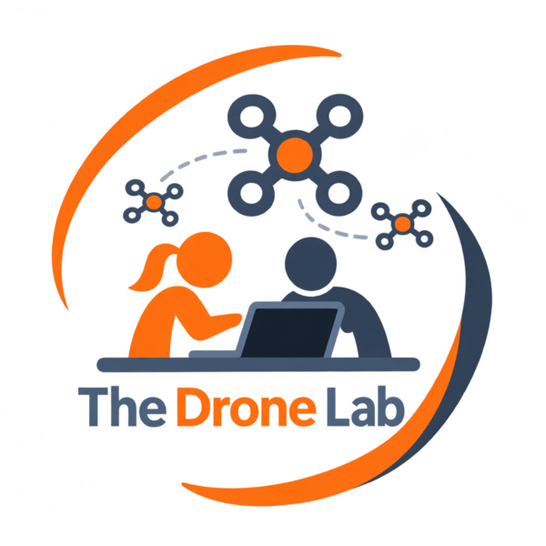

  

<h1 align="center">The Drone Lab</h1>

<strong>Teaching software engineering in the age of AI, with drones.</strong>

🚧 <em>Coming soon.</em> 🚧

---

The Drone Lab is a lightweight, multi-UAV software engineering environment that runs on an ordinary laptop. No drones and no prior UAV experience are needed.

It brings together two shifts in software engineering:

- **Generative AI** is changing *how* software gets built. With AI coding agents, students can take on larger, integrated systems while staying responsible for requirements, architecture, integration and verification.
- **Physical AI** is changing *what* gets built. Autonomous systems that perceive and act in the real world raise questions of uncertainty, safety and human oversight that conventional assignments rarely touch.

The guiding principle: **use AI, but verify, challenge, understand, and take responsibility for the engineered system.**

## Status

The platform, teaching materials and course structure are being prepared for an open-source release. Watch this repository for updates.

Developed at the University of Notre Dame.
Contact: JaneClelandHuang(at)nd(dot)edu

🌐 **Website:** https://dronecolab.github.io/TheDroneLab/
